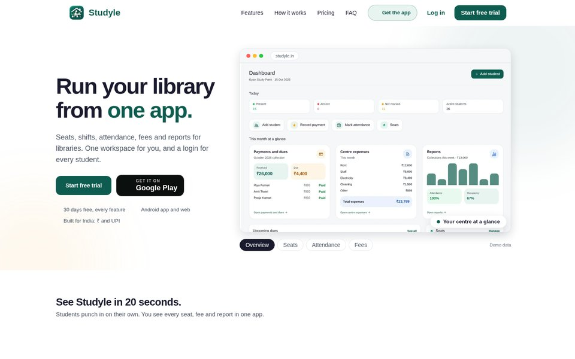
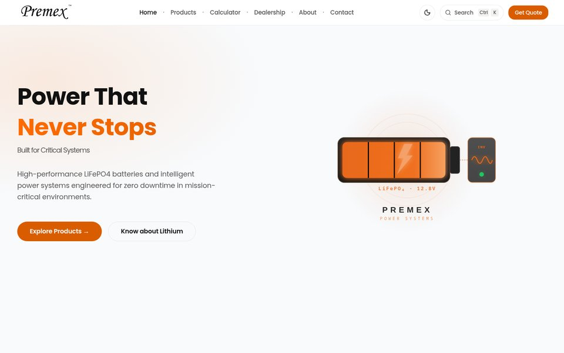
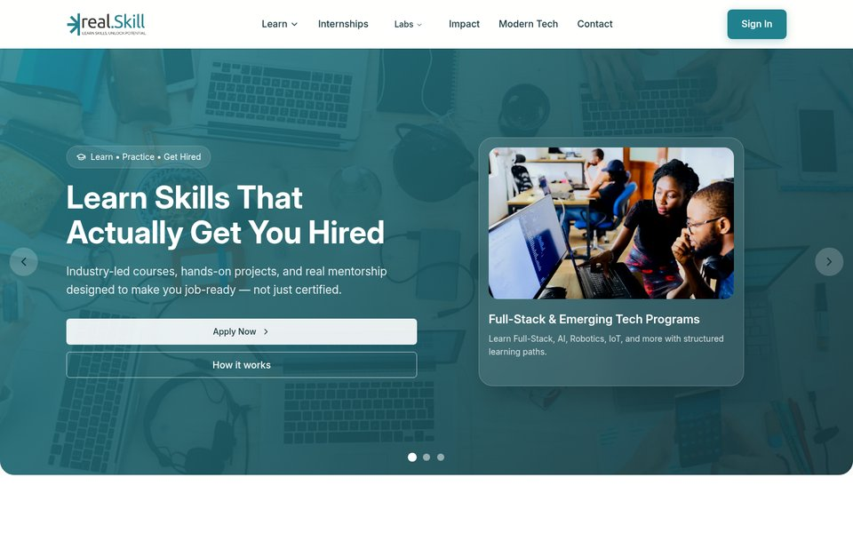
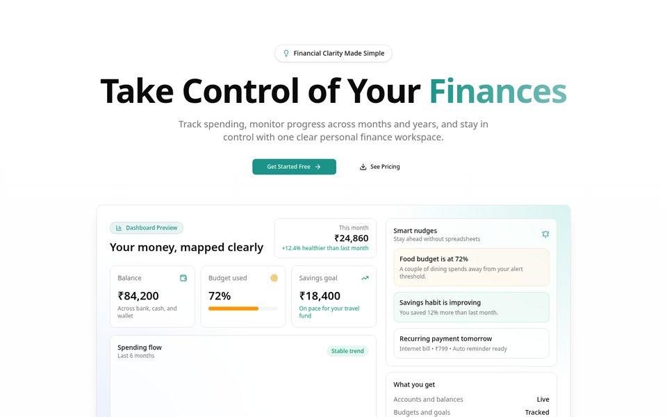
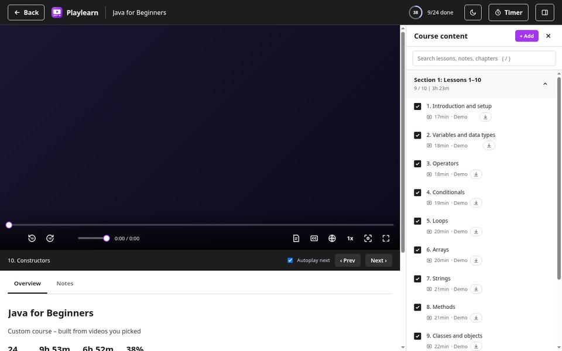
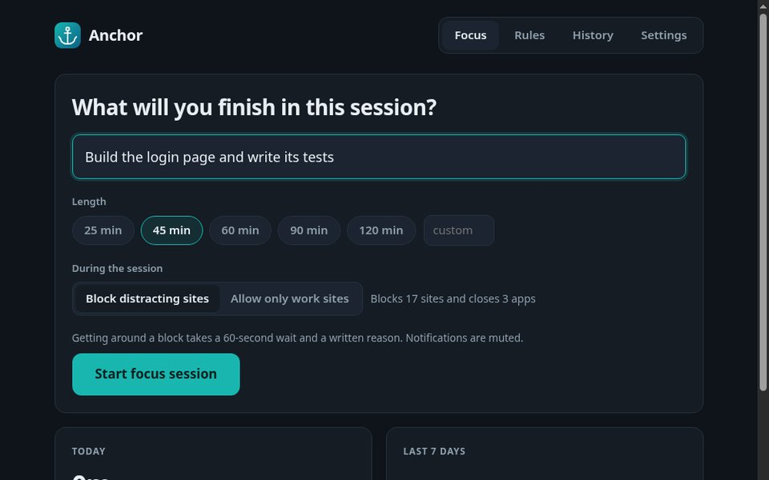
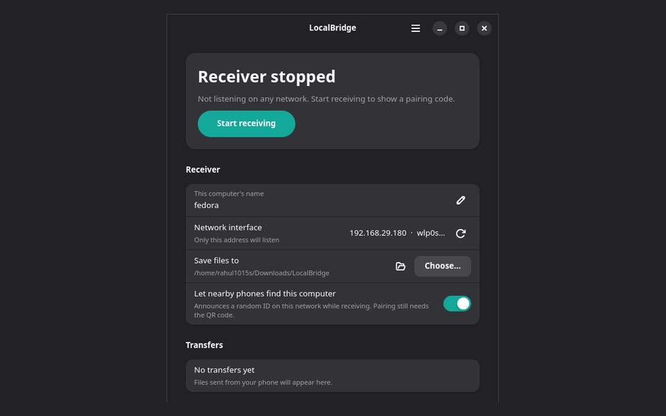

**Looking for an internship or junior developer role. Remote or India.**

 

## Stack

  

  
  
   
  I build with AI coding tools daily to ship faster, and I review and understand what goes into my code.

 

## Things I built

| | |
| :-- | :-- |
|  **Studyle** Library management for India: seats, shifts, attendance and fees. Android app and web. `Expo` `TypeScript` `MongoDB` [Play Store](https://play.google.com/store/apps/details?id=com.vermaxlabs.studyle) · [studyle.in](https://studyle.in) |  **Premex Power Systems** Client site and admin system for a battery company: store, inventory, warranty QR codes. `Next.js` `MongoDB` [Live](https://www.premexpowersystems.com) |
|  **RealSkill** Client website for a skills and learning brand. `Next.js` `Tailwind` [Live](https://www.realskill.in) |  **GenExpence** Expense, budget and invoice tracker. Installable PWA that works offline. `Next.js` `TypeScript` [Live](https://genexpence.vercel.app) · [Code](https://github.com/rahul1015s/genexpence) |
|  **Playlearn** Turns a YouTube playlist into a course with progress, notes and a custom player. Linux desktop app. `JavaScript` [Code](https://github.com/rahul1015s/playlearn) |  **Anchor** Focus sessions that block distracting sites and apps until you finish. Linux desktop and Android. `JavaScript` `Kotlin` [Desktop](https://github.com/rahul1015s/anchor) · [Android](https://github.com/rahul1015s/anchor-android) |
|  **LocalBridge** Send files between phone and Linux over your own Wi-Fi. No cloud. `Kotlin` `Python` [Code](https://github.com/rahul1015s/LocalBridge) |   |

**More**

| Project | What it is | Stack | Links |
| :-- | :-- | :-- | :-- |
| **Carryzo CRM** | CRM for a logistics business, in production. | `Next.js` `MongoDB` | [Live](https://crm.carryzo.in) |
| **frontend-skills** | Prompt kits for generating animated single-file websites. | `HTML` `GSAP` | [Code](https://github.com/rahul1015s/frontend-skills) |

Client project source code is private under their terms. The live sites are linked.

 

  

